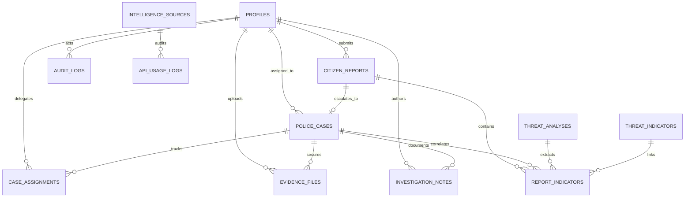

# SURAKSHA SETU — SUPABASE POSTGRESQL DATABASE SCHEMA
## Enterprise Relational Architecture for Law Enforcement Cyber Intelligence
**Target:** Rajasthan Police Cyber Security Hackathon  
**Schema Version:** 2.0.0  
**Storage Engine:** Supabase Managed PostgreSQL 15+

---

## 1. Overview & Data Philosophy

The Suraksha Setu database architecture is engineered to solve a fundamental challenge in cybercrime investigation: **connecting isolated citizen scam complaints into actionable syndicate-level criminal intelligence**.

Key principles:
1. **Strict Data Segregation:** Zero-trust Row Level Security (RLS) policies ensure citizens can never access confidential police dossiers, internal investigative notes, suspect records, or other citizens' submissions.
2. **Normalized IOC Graph Engine:** Indicators of Compromise (`threat_indicators`) are decoupled and mapped via many-to-many junction tables (`report_indicators`), allowing instant multi-case cross-referencing of recurring phone numbers, mule UPI handles, and hosting domains.
3. **Forensic Integrity:** Evidence files store immutable SHA-256 hashes and timestamped custody logs to fulfill strict statutory admissibility standards under Section 65B of the Indian Evidence Act, 1872 / Section 63 of the Bharatiya Sakshya Adhiniyam (BSA), 2023.

---

## 2. Entity Relationship Model

---

## 3. The 12 Relational Tables

### 1. `profiles`
Extends `auth.users` with law enforcement rank, station assignment, and citizen metadata.

| Column | Type | Constraints | Description |
| :--- | :--- | :--- | :--- |
| `id` | `UUID` | PK, REFERENCES `auth.users(id)` | User unique identity |
| `role` | `VARCHAR(32)` | CHECK: `'citizen'`, `'police_officer'`, `'admin'` | Primary authorization role |
| `full_name` | `VARCHAR(255)` | NOT NULL | Full name of officer or citizen |
| `email` | `VARCHAR(255)` | UNIQUE, NOT NULL | Official or personal email |
| `phone` | `VARCHAR(32)` | Nullable | Primary contact telephone |
| `badge_number` | `VARCHAR(64)` | Nullable | Official Police Badge ID (e.g. DL-CY-8412) |
| `police_station` | `VARCHAR(255)` | Nullable | Assigned police station or cyber cell |
| `department` | `VARCHAR(255)` | Nullable | Unit (e.g. Special Cyber Cell IFSO) |
| `is_authorized` | `BOOLEAN` | DEFAULT `false` | Admin authorization toggle for police |
| `avatar_url` | `TEXT` | Nullable | Profile avatar image or icon |
| `created_at` | `TIMESTAMPTZ` | DEFAULT `NOW()` | Registration timestamp |
| `updated_at` | `TIMESTAMPTZ` | DEFAULT `NOW()` | Modification timestamp |

---

### 2. `citizen_reports`
Stores suspicious scans submitted by citizens and records automatic police escalations.

| Column | Type | Constraints | Description |
| :--- | :--- | :--- | :--- |
| `id` | `UUID` | PK, DEFAULT `gen_random_uuid()` | Internal report identity |
| `report_id` | `VARCHAR(64)` | UNIQUE, NOT NULL | Public tracking ID (e.g. `CR-2026-1049`) |
| `citizen_id` | `UUID` | REFERENCES `profiles(id)` | Submitting citizen (if logged in) |
| `scan_type` | `VARCHAR(32)` | CHECK: `'url'`, `'message'`, `'apk'`, `'app_store'`, `'website'` | Format of suspicious digital content |
| `submitted_content` | `TEXT` | NOT NULL | Raw URL, SMS text, or APK metadata |
| `risk_level` | `VARCHAR(16)` | CHECK: `'LOW'`, `'MEDIUM'`, `'HIGH'`, `'CRITICAL'` | Calibrated threat tier |
| `risk_score` | `INTEGER` | CHECK: `0 <= risk_score <= 100` | Exact 0-100 heuristic risk score |
| `detected_indicators` | `JSONB` | DEFAULT `'[]'` | Array of structured threat cues |
| `raw_analysis_result`| `JSONB` | DEFAULT `'{}'` | Full engine output snapshot |
| `status` | `VARCHAR(32)` | CHECK: `'PENDING_REVIEW'`, `'UNDER_INVESTIGATION'`, `'RESOLVED'`, `'DISMISSED'` | Complaint lifecycle status |
| `contact_phone` | `VARCHAR(32)` | Nullable | Citizen callback telephone |
| `contact_email` | `VARCHAR(255)` | Nullable | Citizen notification email |
| `created_at` | `TIMESTAMPTZ` | DEFAULT `NOW()` | Submission timestamp |
| `updated_at` | `TIMESTAMPTZ` | DEFAULT `NOW()` | Modification timestamp |

---

### 3. `police_cases`
Formal cyber investigation records maintained by LEAs.

| Column | Type | Constraints | Description |
| :--- | :--- | :--- | :--- |
| `id` | `UUID` | PK, DEFAULT `gen_random_uuid()` | Internal case UUID |
| `case_id` | `VARCHAR(64)` | UNIQUE, NOT NULL | Official LEA Case Docket ID (e.g. `SS-2026-1049`) |
| `source_report_id` | `UUID` | REFERENCES `citizen_reports(id)` | Originating citizen escalation |
| `title` | `VARCHAR(512)` | NOT NULL | Tactical case title |
| `category` | `VARCHAR(128)` | NOT NULL | Category (e.g. Banking Phishing, Loan Scam) |
| `priority` | `VARCHAR(16)` | CHECK: `'LOW'`, `'MEDIUM'`, `'HIGH'`, `'CRITICAL'` | Investigation priority |
| `status` | `VARCHAR(32)` | CHECK: `'NEW'`, `'UNDER_REVIEW'`, `'ASSIGNED'`, `'INVESTIGATING'`, `'ESCALATED'`, `'RESOLVED'`, `'CLOSED'` | Case status workflow |
| `assigned_officer_id`| `UUID` | REFERENCES `profiles(id)` | Primary IO (Investigating Officer) |
| `assigned_station` | `VARCHAR(255)` | NOT NULL | Investigating jurisdiction / PS |
| `incident_timestamp` | `TIMESTAMPTZ` | DEFAULT `NOW()` | When incident occurred |
| `evidence_hash` | `VARCHAR(64)` | Nullable | Primary evidence SHA-256 checksum |
| `summary` | `TEXT` | Nullable | Tactical intelligence summary |
| `explanation` | `TEXT` | Nullable | Detailed forensic technical findings |
| `recommendations` | `JSONB` | DEFAULT `'[]'` | Actionable legal and containment steps |
| `tags` | `TEXT[]` | DEFAULT `ARRAY[]` | Syndicate or campaign tags |
| `loss_amount_inr` | `NUMERIC(14,2)`| DEFAULT `0.00` | Documented financial loss in INR |
| `created_at` | `TIMESTAMPTZ` | DEFAULT `NOW()` | Registration timestamp |
| `updated_at` | `TIMESTAMPTZ` | DEFAULT `NOW()` | Modification timestamp |

---

### 4. `case_assignments`
Maintains a verifiable audit trail of case handoffs between officers.

| Column | Type | Constraints | Description |
| :--- | :--- | :--- | :--- |
| `id` | `UUID` | PK, DEFAULT `gen_random_uuid()` | Assignment event ID |
| `case_id` | `UUID` | REFERENCES `police_cases(id)` | Target investigation case |
| `assigned_by` | `UUID` | REFERENCES `profiles(id)` | Delegating supervisor |
| `assigned_to` | `UUID` | REFERENCES `profiles(id)` | Assignee officer |
| `previous_officer_id`| `UUID` | REFERENCES `profiles(id)` | Previous officer (if reassignment) |
| `notes` | `TEXT` | Nullable | Operational instructions / notes |
| `assigned_at` | `TIMESTAMPTZ` | DEFAULT `NOW()` | Handoff timestamp |

---

### 5. `threat_analyses`
Deep forensic analysis records for individual digital artifacts.

| Column | Type | Constraints | Description |
| :--- | :--- | :--- | :--- |
| `id` | `UUID` | PK, DEFAULT `gen_random_uuid()` | Analysis UUID |
| `target_type` | `VARCHAR(32)` | CHECK: `'URL'`, `'MESSAGE'`, `'APK'`, `'DOMAIN'`, `'IP'` | Target artifact format |
| `target_value` | `TEXT` | NOT NULL | Artifact payload or URL string |
| `risk_score` | `INTEGER` | CHECK: `0 <= risk_score <= 100` | Calibrated risk metric |
| `risk_level` | `VARCHAR(16)` | CHECK: `'LOW'`, `'MEDIUM'`, `'HIGH'`, `'CRITICAL'` | Severity classification |
| `findings` | `JSONB` | DEFAULT `'[]'` | Structured explainable observations |
| `heuristics_triggered`| `JSONB` | DEFAULT `'[]'` | Heuristic engine detection flags |
| `external_intel` | `JSONB` | DEFAULT `'{}'` | OSINT intelligence feeds (VT, AbuseIPDB) |
| `sha256_fingerprint` | `VARCHAR(64)`| Nullable | Hash fingerprint of analyzed artifact |
| `analyzed_at` | `TIMESTAMPTZ` | DEFAULT `NOW()` | Analysis execution timestamp |

---

### 6. `threat_indicators`
Central normalized directory of all observed IOCs across Rajasthan and nationwide complaints.

| Column | Type | Constraints | Description |
| :--- | :--- | :--- | :--- |
| `id` | `UUID` | PK, DEFAULT `gen_random_uuid()` | Indicator UUID |
| `indicator_type` | `VARCHAR(32)` | CHECK: `'PHONE'`, `'UPI'`, `'DOMAIN'`, `'IP'`, `'URL_HASH'`, `'APK_HASH'`, `'BANK_ACCOUNT'` | IOC taxonomy |
| `indicator_value` | `VARCHAR(512)` | NOT NULL | Normalized value (+9198..., handle@upi) |
| `risk_weight` | `INTEGER` | DEFAULT `10` | Heuristic severity weight (1-50) |
| `times_observed` | `INTEGER` | DEFAULT `1` | Frequency counter across complaints |
| `first_seen` | `TIMESTAMPTZ` | DEFAULT `NOW()` | Earliest recorded complaint |
| `last_seen` | `TIMESTAMPTZ` | DEFAULT `NOW()` | Most recent recorded activity |
| `threat_tags` | `TEXT[]` | DEFAULT `ARRAY[]` | Associated scam patterns |
| `associated_syndicate`| `VARCHAR(255)`| Nullable | Identified organized criminal group |
| `is_active` | `BOOLEAN` | DEFAULT `true` | Active threat indicator |

---

### 7. `report_indicators`
Junction table mapping complaints, police cases, and analyses to threat indicators.

| Column | Type | Constraints | Description |
| :--- | :--- | :--- | :--- |
| `id` | `UUID` | PK, DEFAULT `gen_random_uuid()` | Junction ID |
| `indicator_id` | `UUID` | REFERENCES `threat_indicators(id)` | Linked indicator |
| `report_id` | `UUID` | REFERENCES `citizen_reports(id)` | Originating citizen report (if any) |
| `case_id` | `UUID` | REFERENCES `police_cases(id)` | Linked police case (if any) |
| `analysis_id` | `UUID` | REFERENCES `threat_analyses(id)` | Threat analysis record |
| `context_role` | `VARCHAR(64)` | DEFAULT `'vector'` | Role: `'vector'`, `'mule'`, `'c2_host'`, `'caller'` |
| `created_at` | `TIMESTAMPTZ` | DEFAULT `NOW()` | Linkage creation timestamp |

---

### 8. `evidence_files`
Section 65B compliant digital evidence vault with cryptographic custody logging.

| Column | Type | Constraints | Description |
| :--- | :--- | :--- | :--- |
| `id` | `UUID` | PK, DEFAULT `gen_random_uuid()` | Evidence item ID |
| `case_id` | `UUID` | REFERENCES `police_cases(id)` | Parent investigation docket |
| `uploader_id` | `UUID` | REFERENCES `profiles(id)` | Officer or system that seized artifact |
| `file_name` | `VARCHAR(255)` | NOT NULL | Original file name |
| `file_type` | `VARCHAR(128)` | NOT NULL | MIME / artifact type |
| `file_size_bytes` | `BIGINT` | NOT NULL | Byte length |
| `storage_path` | `TEXT` | NOT NULL | Secure Supabase Storage path |
| `sha256_hash` | `VARCHAR(64)` | NOT NULL | Immutable SHA-256 checksum |
| `custody_chain` | `JSONB` | DEFAULT `'[]'` | Chronological log of officer access |
| `is_tamper_verified`| `BOOLEAN` | DEFAULT `true` | Hash re-verification verification pass |
| `uploaded_at` | `TIMESTAMPTZ` | DEFAULT `NOW()` | Evidence ingestion timestamp |

---

### 9. `investigation_notes`
Case notebook for investigators, forensic analysts, and prosecutors.

| Column | Type | Constraints | Description |
| :--- | :--- | :--- | :--- |
| `id` | `UUID` | PK, DEFAULT `gen_random_uuid()` | Note UUID |
| `case_id` | `UUID` | REFERENCES `police_cases(id)` | Case docket reference |
| `officer_id` | `UUID` | REFERENCES `profiles(id)` | Authoring officer |
| `note_text` | `TEXT` | NOT NULL | Narrative note / case directive |
| `is_internal` | `BOOLEAN` | DEFAULT `true` | Restrict visibility strictly to police |
| `created_at` | `TIMESTAMPTZ` | DEFAULT `NOW()` | Creation timestamp |

---

### 10. `audit_logs`
Tamper-proof compliance log capturing every access, update, and export event.

| Column | Type | Constraints | Description |
| :--- | :--- | :--- | :--- |
| `id` | `UUID` | PK, DEFAULT `gen_random_uuid()` | Audit record ID |
| `actor_id` | `UUID` | REFERENCES `profiles(id)` | Officer or user performing action |
| `action` | `VARCHAR(128)` | NOT NULL | Action (e.g. `CASE_VIEW`, `EVIDENCE_EXPORT`) |
| `entity_type` | `VARCHAR(64)` | NOT NULL | Target entity (`CASE`, `EVIDENCE`, `REPORT`) |
| `entity_id` | `VARCHAR(128)` | NOT NULL | Target entity primary key |
| `ip_address` | `VARCHAR(45)` | Nullable | Client IP address |
| `user_agent` | `TEXT` | Nullable | Browser / client identifier |
| `details` | `JSONB` | DEFAULT `'{}'` | Snapshot of parameters or state change |
| `created_at` | `TIMESTAMPTZ` | DEFAULT `NOW()` | Tamper-proof timestamp |

---

### 11. `intelligence_sources`
Tracks external threat intelligence feeds, quota usage, and connectivity status.

| Column | Type | Constraints | Description |
| :--- | :--- | :--- | :--- |
| `id` | `UUID` | PK, DEFAULT `gen_random_uuid()` | Source ID |
| `source_name` | `VARCHAR(64)` | UNIQUE, NOT NULL | Feed name (VirusTotal, URLhaus, AbuseIPDB) |
| `query_count` | `INTEGER` | DEFAULT `0` | Cumulative queries issued |
| `last_queried_at` | `TIMESTAMPTZ` | Nullable | Most recent API call |
| `status` | `VARCHAR(32)` | CHECK: `'ACTIVE'`, `'RATE_LIMITED'`, `'DOWN'`, `'UNCONFIGURED'` | Operational health status |
| `config` | `JSONB` | DEFAULT `'{}'` | Source limits and configuration |
| `created_at` | `TIMESTAMPTZ` | DEFAULT `NOW()` | Inception timestamp |

---

### 12. `api_usage_logs`
Fine-grained latency, quota, and HTTP status logging for external OSINT calls.

| Column | Type | Constraints | Description |
| :--- | :--- | :--- | :--- |
| `id` | `UUID` | PK, DEFAULT `gen_random_uuid()` | Log entry ID |
| `source_id` | `UUID` | REFERENCES `intelligence_sources(id)` | Parent source |
| `endpoint` | `VARCHAR(255)` | NOT NULL | Requested API URL / endpoint |
| `status_code` | `INTEGER` | NOT NULL | HTTP response code (200, 429, 500) |
| `response_time_ms`| `INTEGER` | NOT NULL | Execution latency in milliseconds |
| `created_at` | `TIMESTAMPTZ` | DEFAULT `NOW()` | Request timestamp |

---

## 4. Row Level Security (RLS) Policy Summary

| Table | Policy Name | Permitted Roles | SQL Condition |
| :--- | :--- | :--- | :--- |
| `profiles` | Users can read own profile | All | `auth.uid() = id` |
| `profiles` | Officers can read officer profiles | Police Officer, Admin | `EXISTS (SELECT 1 FROM profiles WHERE id = auth.uid() AND role IN ('police_officer', 'admin'))` |
| `citizen_reports` | Citizens can insert own reports | Citizen | `auth.uid() = citizen_id` |
| `citizen_reports` | Citizens can view own reports | Citizen | `auth.uid() = citizen_id` |
| `citizen_reports` | Police view all citizen reports | Police Officer, Admin | Role is police officer or admin |
| `police_cases` | Police view and manage cases | Police Officer, Admin | Role is police officer or admin |
| `evidence_files` | Police access evidence files | Police Officer, Admin | Role is police officer or admin |
| `investigation_notes` | Police access investigation notes | Police Officer, Admin | Role is police officer or admin |
| `threat_analyses` | Anyone can insert threat analyses | All | `true` |
| `threat_analyses` | Police view all threat analyses | Police Officer, Admin | Role is police officer or admin |
| `threat_indicators`| Police access threat indicators | Police Officer, Admin | Role is police officer or admin |
| `audit_logs` | Admins can view audit logs | Admin | Role is admin |
